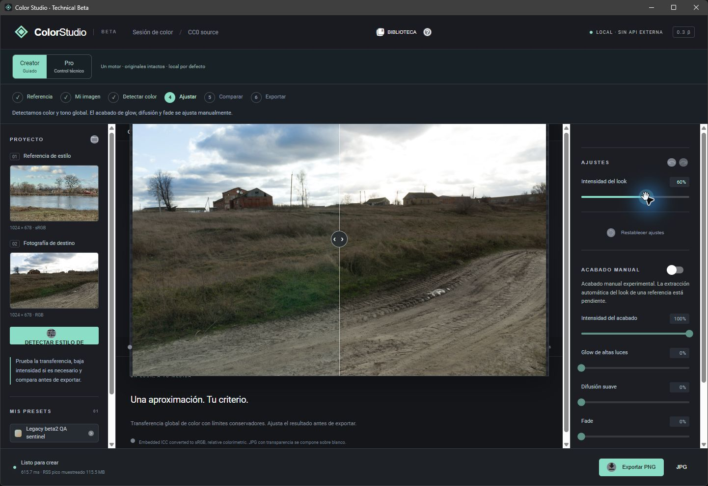
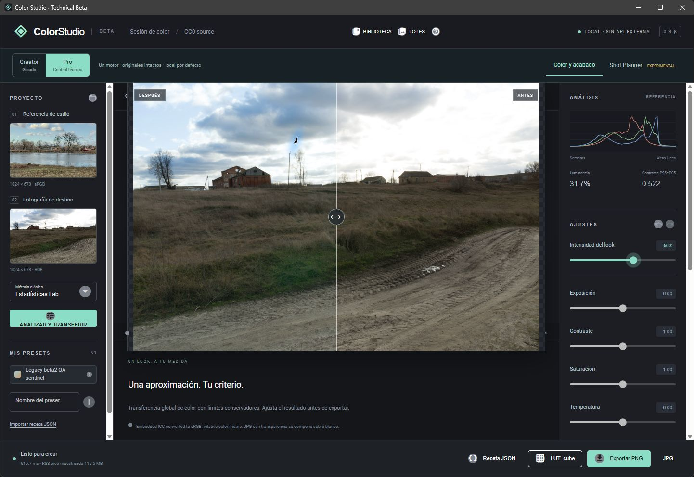
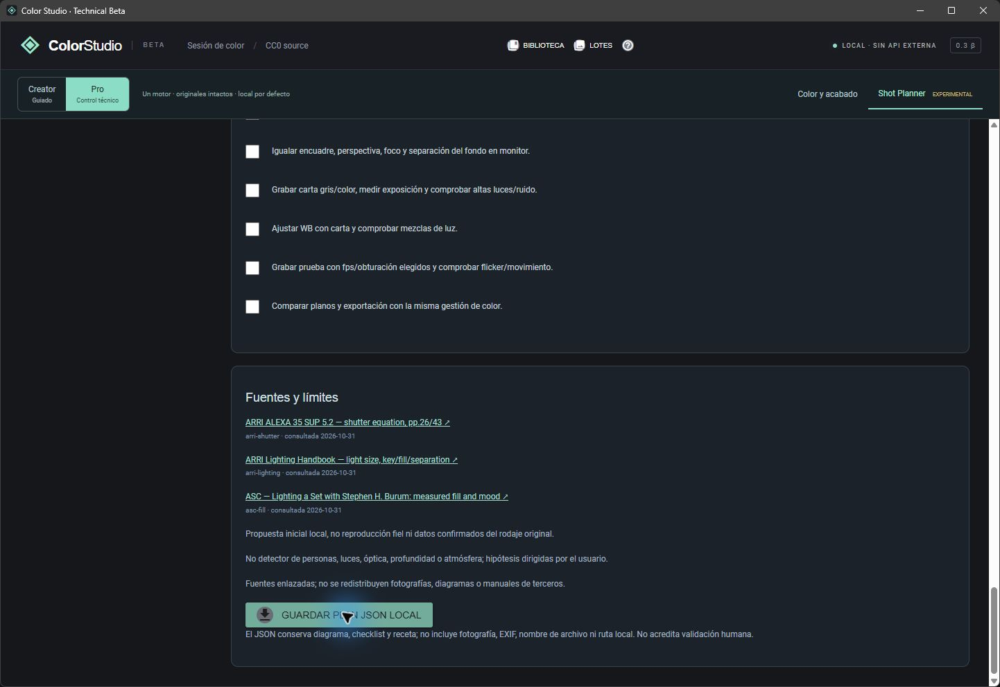

# COL036 · beta.4 interna: pruebas y bloqueo de conservación

Informe del 02-11-2026. [PR90](https://github.com/jea27/Lut_generator/pull/90),
[tarea57](https://github.com/jea27/Lut_generator/issues/57) y
[solicitud67](https://github.com/jea27/Lut_generator/issues/67).
**PR en borrador; conservación global sin aceptar; beta externa y venta NO-GO.**

## Candidato verificable

- Color Studio 0.3.0-beta.4, fuente limpia `8f4c60ecbbb25a5681796f7509e20e2eebe6f144`.
- Setup interno de 48.473.370 bytes; SHA256
  `f002769da0c37d8a85a8fa8bf6351053ea3608a298cbf368d0c442f164eca4bf`.
- [Metadatos](UPGRADE_036_ARTIFACT.json), [extracción completa NSIS](UPGRADE_036_NSIS_AUDIT.json),
  [resultados sanitizados](UPGRADE_036_QA.json) y [recibo CI](UPGRADE_036_CI_BUILD.json).
- [Construcción CI41399176754](https://github.com/jea27/Lut_generator/actions/runs/41399176754)
  correcta para esa fuente. Sus4JSON se verificaron contra el digest del artefacto
  GitHub. No incluyen un instalador. Runtime,60 componentes nativos y bootstrapper
  coinciden con el local; el setup CI tiene otro hash y no se ejecutó. No se afirma
  reproducibilidad binaria idéntica de NSIS/launcher.
- Cambios posteriores de esta PR: instrumentos de diagnóstico, auditor de módulos,
  tests y documentación. No cambian el paquete construido ni requieren atribuir a
  este setup una fuente posterior que no lo produjo.

## Pruebas realmente ejecutadas

Entorno: host Windows existente desde contexto Codex/MSIX. No es una VM limpia.

| Comprobación | Resultado observado |
|---|---|
| Actualización directa beta.3→beta.4 | Exit0,8,016s; stores de entrada/salida idénticos |
| Actualización directa beta.2→beta.4 | Exit0,7,110s; preset recuperado por API; stores idénticos |
| Fallo nativo controlado al renombrar stage | NSIS2/hijo2; `directory_switch_failed`, errno13/Winerror32; instalación anterior restaurada byte a byte |
| Reintento tras ese fallo | Exit0,8,438s, sin modificar stores |
| Registro con nombre de archivo sintético manipulado | Fixture conservado; campo de registro restablecido por instalador |
| Desinstalador final con junction de runtime | Exit2 antes de borrar launcher; destino externo y stores intactos; runtime restaurado byte a byte |
| Guard de desinstalación NSIS aislado |5 casos reales: normal/ausente0, junction raíz/recurso/ancestro2; marcadores intactos |
| Desinstalación normal | Finalización observada, carpeta/registro retirados, stores intactos. Parent0; no se capturó el exit del hijo temporal |
| Regresión con Python embebido instalado |116 tests,0 fallos/errores,3 symlink omitidos; núcleo cargado desde paquete, QA extras separados |
| Seguimiento y estados del dashboard |132 tests correctos; conservación independiente de CI/etiquetas y bloqueo visible frente a revisión pendiente |
| Aislamiento tras reinicio | Flags-I/-S, CWD/env contaminados ignorados, preferencias/preset conservados,71 módulos nativos cotejados |
| API con2 fotografías demo CC0 | Creator/Pro exportan bytes idénticos; PNG/JPEG, receta/óptica, preset, lote2, LUT y Planner pasan; originales intactos |

El error32 se provocó con un handle propio sin permiso de borrado sobre el stage.
Reproduce un fallo real de cambio de directorios y su recuperación; **no identifica
el2 histórico de beta.3**. La repetición original beta.2→beta.3 dio0 y ese incidente
continúa sin causa demostrada. Desinstalar/reinstalar solo preparó líneas base.

Los tres tests de symlink se omiten por privilegios; no se elevaron ni cambiaron
protecciones. Los cinco casos de junction se ejecutaron con permisos disponibles.
La protección de app abierta se verificó en el candidato intermedio antes de copiar;
la función no cambió en el seleccionado. No se atribuye un retest inexistente.

El auditor QA de módulos ahora consulta las rutas del loader mediante PSAPI y
verifica límites del paquete y hashes. `memory_maps` devolvía nombres de secciones
de un stage antiguo tras renombrarlo. Tres regresiones comprueban proceso propio,
mayúsculas de Windows/tamper y rechazo de una DLL idéntica fuera del paquete.
No se relajan comprobaciones de origen. Las pruebas del diagnóstico son sintéticas,
sin utilizar imágenes privadas ni presentarse como evidencia de conservación real.

## Evidencia visual y su alcance

GUI nativa ejecutada en el candidato intermedio SHA25c943dc…505f, con árboles Git
`apps/` y `packages/` idénticos a8f4c60e; cambios finales limitados al empaquetado.
El instalador final y su arranque se probaron por separado. No se presenta la GUI
intermedia como una repetición visual del setup final.

Creator→Pro conserva las imágenes y60% de intensidad. Se observaron descargas
reales de PNG1024×678 con ICC, receta y PlannerJSON. Planner conserva los tipos
observación/estimación/recomendación/fuente y `human_validated=false`. Cierre normal
y cierre de hijos comprobados. No demuestra fidelidad estética ni aprobación humana.

Fotografías: Sergej Majboroda / Poly Haven / CC0-1.0; procedencia en
[créditos de demo](../../apps/demo/credits.json). No fotografías personales.

## Bloqueo real: nueve archivos frente a cinco

La captura inicial tenía6 imágenes temporales,2 presets y preferencias. Ahora
hay2 imágenes y los mismos2 presets/preferencias; los5 hashes presentes coinciden.
El operador **niega haber limpiado temporales** y solicita investigar antes de aceptar.
Los nombres, hashes privados, ubicaciones y registros sin sanear quedan fuera de Git.

Cada ensayo tiene comparación inmediata antes/después idéntica. No cubre todo el
intervalo entre sesiones y no resuelve los4 ausentes. Las búsquedas de copias y
la revisión acotada del historial no identificaron su destino ni una orden de borrado.
Las distintas vistas consultadas coinciden actualmente en5; la captura inicial no
registró identidad física del directorio. No atribuir la diferencia a otras API.

Leer el diario NTFS desde esta sesión devuelve Acceso denegado5. El
[instrumento de solo lectura](../../scripts/diagnose_private_store.ps1) está probado;
registra también identidades actuales para comparar el contexto fuera de Codex.
[Pasos para el operador y privacidad](../DIAGNOSTICO_TEMPORALES_BETA4.md).
No se restaura ni borra ningún archivo. La falta de filas USN no acreditaría que no
hubo borrado, por su retención limitada. La aceptación permanece bloqueada.

## Seguridad y puertas pendientes

Extracción exacta de951 archivos/924runtime,0 hallazgos de privacidad en el alcance
del auditor. Procedencia fijada de Python, wheels y herramientas; no se copiaron DLL
del host. Se eliminó el Delete dirigido por un campo de registro no fiable y se
comprueban reparse/junction antes del primer Delete del desinstalador. No se garantiza
resistencia frente a manipulación hostil concurrente por la misma cuenta.

El setup sigue sin firma comercial. Bootstrapper Microsoft Evergreen firmado y
fijado por SHA; si falta Evergreen, su instalación necesita Internet. No se ejecutó
esa descarga en un Windows que carezca de WebView2. Firmas/procedencia no sustituyen
aceptación jurídica de condiciones propietarias; [Issue60](https://github.com/jea27/Lut_generator/issues/60)
sigue abierta/bloqueada. No ejecutar desinstaladores de backups sobre el producto activo.

Pendiente: explicar4 ausentes, Windows10/11 limpio, actualización en ese entorno,
uso físicamente desconectado, LUT en Resolve real y Adobe solo con licencia válida,
derechos/seguridad y revisión/autorización humana. Hyper-V/ISO/Resolve requieren
preparación del operador según67. No se creó VM ni se habilitó virtualización.

El manifiesto incorpora PR90 y una puerta de conservación global independiente del
éxito técnico. GitHub Actions mantiene los estados; no se editan estados del roadmap.
Ningún merge, check o notificación aprueba capacidades ni autoriza distribución.

Integración con metadatos reales: [recibo del sincronizador](UPGRADE_036_SYNC.json).
La proyección de esta PR muestra Windows bloqueado, sin aprobación humana, candidato
beta.4 interno y conservación pendiente. La web pública consultada ya mostraba
COL036 bloqueada y enlazaba PR90, pero conserva la versión beta.3 de main. Se detectó
que un recibo de revisión obsoleto podía reemplazar visualmente el estado bloqueado:
corregido en esta PR, conservando el historial y observaciones. No está desplegado.

El [aviso41410069177](https://github.com/jea27/Lut_generator/actions/runs/41410069177)
terminó correctamente y se comprobó la
[mención del bot](https://github.com/jea27/Lut_generator/issues/67#issuecomment-6572098610).
No se presume recepción nueva en el teléfono ni aprobación. Se reutiliza67 y no se
retira/reaplica needs-human.
